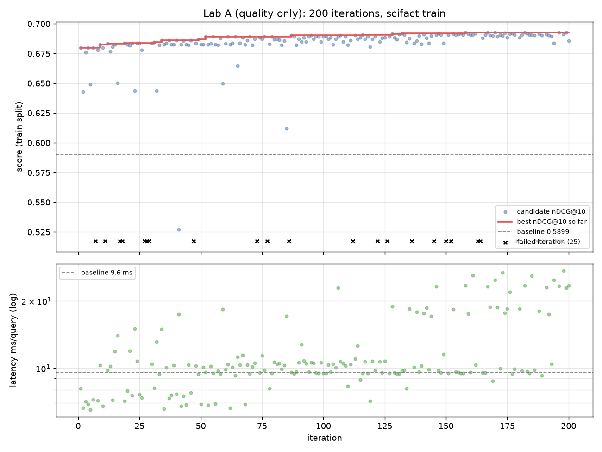

# Lab A (quality-only fitness): results of the 200-iteration run

**Run:** 2026-11-26, 16:13 → 17:30 (1 h 17 min), on a MacBook Air, nothing else running.
**Fitness:** `combined_score = nDCG@10` on BEIR SciFact **train** (809 queries). Latency is measured and reported, but not rewarded.
**Setup:** `openevolve_task/lab_quality_only/{evaluator.py,config.yaml}` at `main` @ `8333507`. The ensemble was set to Haiku 5.5 (0.85) + DeepSeek V4 Pro (0.15), temperature 1.0, `max_tokens` 4096, 3 islands, diff-based evolution.

All numbers below are on the **train** split, which the evolution used as its feedback signal. The test split is still untouched. It's reserved for Phase 3, where the baseline, Lab A's winner and Lab B's winner are evaluated together under the same conditions.

## Headline

| | nDCG@10 | Recall@10 | Latency (ms/query) |
|---|---|---|---|
| Baseline (`initial_program.py`, measured in this run) | 0.5899 | 0.7201 | 9.6 |
| **Lab A best** (iteration 170, generation 9) | **0.6928** | **0.8060** | **24.8** |
| Change | **+0.1029 (+17.4%)** | +0.0859 | **2.6x slower** |



## What the numbers say

1. **Most of the gain came in the very first iteration.** Iteration 1 already scored 0.6800 (+0.090). The next 199 iterations added **+0.013**. The milestones: ≥0.68 at iteration 1, ≥0.69 at iteration 87, and the final 0.6928 first at iteration 158. The 5-iteration smoke test (2026-11-20) had already reached 0.6885.
2. **The late gains are small and may be overfitting.** After iteration 52, each new best came from tweaking a feature weight (e.g. `0.25 * tb` → `0.3 * tb`) and added +0.0001 to +0.0011 each, +0.0037 in total. On 809 queries that is within what tuning on the train set alone could produce. The test split in Phase 3 will show whether any of it holds up.
3. **The search was stable, and no candidate tried to cheat.** Of the 175 candidates that ran, 162 scored ≥0.68. Only 1 scored below the baseline, and none was rejected by the source check or failed to evaluate (0 candidates scored 0).
4. **Latency got worse, because nothing rewarded it.** The first ~50 iterations were *faster* than the baseline (6.5–8 ms), since cleaner tokenization produces fewer tokens. Later, the search added per-query features that loop over all 5,183 documents, and the winner is 2.6x slower (24.8 ms). This is the baseline Lab B is compared against: Lab A buys its last +0.003 nDCG with a 2.6x slowdown.

## What evolution discovered

The winning program (`best_program.py`) is still BM25 at its core. These are the changes evolution added, roughly in the order they appeared:

| Change | Kind |
|---|---|
| Regex tokenizer `[a-z0-9]+`: strips punctuation, which the baseline's `.split()` kept ("brain," ≠ "brain") | tokenization |
| Stopword list (~60 words) | tokenization |
| Crude suffix stemming: `-ies → -y`, then strip `-ing/-ed/-es/-s` from words longer than 4 characters | tokenization |
| Title repeated twice before the abstract | field weighting |
| BM25 `k1=0.9, b=0.4` (library defaults: 1.5 / 0.75) | parameter tuning |
| Query terms de-duplicated | query processing |
| **Title coverage** bonus: fraction of query terms present in the title (`+0.3 ×`, after normalizing BM25 to max 1) | new feature |
| **Bigram proximity** bonus: fraction of query word pairs that appear next to each other in the document (`+0.25 ×`) | new feature |
| **Pseudo-relevance feedback**: boost documents whose vocabulary overlaps the top-5 first-pass results (`+0.15 ×`) | new feature |

The three new features are each computed for every document and every query, which is where the 2.6x slowdown comes from. The code has one stale comment ("top-3"; the code uses top-5). Everything in the program is ordinary computation: no file access, nothing read from the relevance labels.

## Problems found

### DeepSeek V4 Pro never produced a usable program, so the run was effectively Haiku-only
- **25 of 200 iterations (12.5%) failed** with `No valid diffs found in response`, and **every one** stopped at exactly 4,096 completion tokens, which is the config's `max_tokens`. The answer was cut off before the code change was complete.
- **Cause:** DeepSeek V4 Pro is a reasoning model. Its hidden reasoning tokens count against `max_tokens`. In a direct test, 154 of the 165 output tokens for a one-line function were reasoning. A full code change needs far more, so the visible answer never fits.
- **Evidence that the failures are DeepSeek's:** OpenEvolve doesn't log the model for failed iterations, but:
  - 135 of the 175 successful programs are still in the final database, and **all 135 are Haiku**. The other 40 were dropped from the database, so their model is unknown.
  - At a 15% weight, DeepSeek should get about 30 ± 5 of the 200 calls, which fits 25 failures.
  - Haiku's answers are short: 90% are under 2,392 tokens, and only one reached 4,096.
- **Consequences:**
  - The planned 85/15 model ensemble was never actually tested.
  - About 12% of the iterations (and their tokens) were wasted.
  - **Lab B uses the same config, so it will have the same problem unless `max_tokens` is raised.** Raising it for Lab B only would make the two labs differ in which models they actually use. See "Decision needed before Lab B" below.

### Smaller notes
- **Ties for the best program:** the best score of 0.6928 was first reached at iteration 158. OpenEvolve's saved winner is from iteration 170 (same score; it changes the feedback from top-3 to top-5 documents).
- **Missing checkpoints:** `checkpoint_150` and `checkpoint_190` don't exist because iterations 150 and 190 failed. Checkpoints are saved only after a successful iteration at those numbers.

## Cost

200 LLM calls, **1.91M tokens** (1.52M prompt, 0.39M completion). The prompt grows as the program database fills up: about 1.6k tokens at the start, 7–11.5k by the end. For the dollar amount, check the Anthropic and DeepSeek consoles, since this summary doesn't hard-code prices. DeepSeek's 25 failed calls were billed too.

## Decision needed before Lab B

Lab A and Lab B must run under the same conditions, so the options are:

1. **Leave `max_tokens` at 4096 for Lab B.** The comparison stays fair, but both labs are then Haiku-only in practice, and the report has to say so. No extra cost.
2. **Raise `max_tokens` (e.g. to 16384) in both configs, and re-run Lab A before or after Lab B.** Both labs then actually use the 85/15 ensemble, as planned. Extra cost: one more Lab A run (~1 h 20 min and about the same token count as this one).
3. Raise it for Lab B only. **Not recommended**: the labs would then differ in fitness *and* in which models they used, so the comparison would no longer isolate the effect of the fitness function.

## Reproduce

```bash
# the run (from main @ 8333507, ~1 h 20 min, real API calls)
uv run --env-file .env openevolve-run openevolve_task/initial_program.py \
  openevolve_task/lab_quality_only/evaluator.py \
  --config openevolve_task/lab_quality_only/config.yaml \
  --output openevolve_task/lab_quality_only/openevolve_output --iterations 200

# this folder (no API calls, just reads the output folder)
uv run python scripts/summarize_run.py openevolve_task/lab_quality_only/openevolve_output \
  results/lab_quality_only --title "Lab A (quality only): 200 iterations, scifact train"

# re-score the winner
uv run python openevolve_task/lab_quality_only/evaluator.py results/lab_quality_only/best_program.py
```

Files: `iterations.csv` (one row per iteration), `summary.json` (headline numbers), `progress.png`, `best_program.py`, `best_program_info.json`. The raw OpenEvolve output (log and checkpoints, 32 MB) is gitignored and stays on this laptop.
